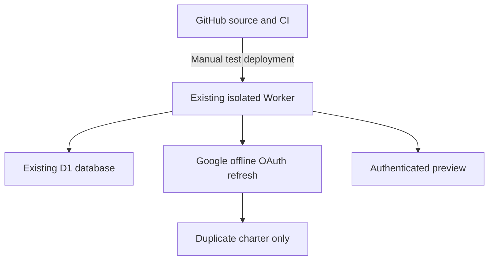

# Architecture and technical inventory

Reviewed 2026-11-17 WAT. Phase 2 code is implemented; independent Google consent and live runtime acceptance remain incomplete. See CHANGELOG for the exact source/deployment evidence.

Public URL and preview URLs are disabled. No Cron, form sender or email sender is active. GitHub push runs CI; it does not deploy.

## Modules

| Module | Responsibility |
|---|---|
| `src/config.mjs` | Immutable duplicate IDs, four slots, WAT and NIL |
| `src/google-docs.mjs` | Fixed-endpoint OAuth refresh and duplicate-only Docs GET; expiry cache, revoked-consent errors, one 401 retry |
| `src/workday.mjs` | Calendar validation, current WAT date, conservative optional preview task selection |
| `src/parser.mjs` | Recursive child tabs and nested tables, date/task boundaries, heading context, source references, known administrative-note exclusion |
| `src/task-identity.mjs` | SHA-256 of Doc/tab/date/slot/context/normalized assignment; duplicate identity detection |
| `src/report.mjs` | Unverified default; exact-assignment explicit statuses; source links/context; NIL; no attendance claim |
| `src/index.mjs` | Bearer-protected API, current-source identity validation before status writes, redacted errors; no sending |
| `migrations/0002_task_identity.sql` | Additive identity status table; legacy records preserved |
| `scripts/deploy-test.mjs` | Fixed account/Worker/DB checks, schema prerequisite, revision annotation and disabled-exposure checks |

## Infrastructure

- Primary Cloudflare account `e6279978097c9f10b46e7eb23e90d34f`.
- Existing Worker `vephla-report-agent-test`; do not recreate.
- Existing D1 `vephla-report-agent-test-db`, ID `9dc42a9e-7b87-43d1-8996-e777135438a3`, binding `DB`.
- Secret `ADMIN_TOKEN` exists. Google OAuth secrets remain absent at inspection.
- `BUILD_COMMIT` identifies the code release on health responses after deployment.
- Before this session's code release, API inspection confirmed an older standalone script, fixture fallback, deployment `71791b06-9f2f-4e7d-ba08-caced7c45802`, version `315822cf-8ad0-440d-a079-aa4043d5dc1b`. Current tested release `e28a27572abcd309797281cf11798995f354b1a9` supersedes it: deployment `40ebe480-3cc7-41c4-bedd-c2f04818ed7f`, version `a0367b43-7283-422b-a623-99674969ab55`. Downloaded module exactly matches the built artifact. Migration 0002 is applied; actual HTTP runtime remains unverified.

## Auth and secret boundary

The Worker needs its own OAuth client and offline grant. ChatGPT's Drive connector and browser sign-in are separate identities. The implementation expects only `documents.readonly`; that scope is account-wide for Docs. The immutable ID is an application boundary, not provider-enforced single-file authorization. Dedicated duplicate-only Viewer identity is preferred, and actual consent remains an external gate. See [OAuth setup](GOOGLE_OAUTH_SETUP.md).

Access tokens are cached in isolate memory only, with early expiry and shared in-flight refresh. A changed bindings credential tuple invalidates that cache. Rotated refresh-token responses require secure operator installation; they are not logged or persisted automatically. Raw upstream errors never appear in API responses.

## Data and status contracts

- `task_status`: legacy index-based records retained but not used by the new status API.
- `task_status_v2`: `(report_date,slot,task_id)` primary key; allowed statuses completed/in-progress/blocked/unverified. No automatic transfer from index statuses. Exact content/context changes lose inherited confirmation; duplicate identities cannot be confirmed.
- `report_runs`: historical scaffold, not a complete submission ledger. Preview requests currently do not persist full report content.
- `/status` now requires a SHA-256 `taskId` from the current preview; old `taskIndex` payloads are rejected. The source is reread before confirming a current identity.
- Source indexes and links are returned only through the protected preview, never public logs. Headings are context; substeps remain separate entries. Classification is heuristic and requires wider source acceptance.
- Completion of a brief review never means its project/prototype is finished. All unknown assignments remain Unverified. Evidence is always exactly NIL.

## Time and source acceptance

The connected Google tool read the actual duplicate November tab. Local Nov 17 Task 2 extraction yielded 33 nonempty lines, 22 assignment/substep entries and 11 context/instruction lines; all assignments Unverified, no Task 3 leakage. Raw charter data was kept out of the public repository. This is connector-plus-local evidence, not an independent Worker read.

Preview defaults use today's Africa/Lagos date. During 08:00–12:00 the default charter section is Task 2; during 12:00–15:00 Task 3. Explicit slot is required for historical, weekend, pre-workday and 15:00 onward requests. Future reports are rejected. Task 1 previous-workday semantics, holidays, first clock-in 8 vs 9 and final clock-in policy remain unresolved. No schedule is enabled.

## Remaining acceptance gates

Independent OAuth client/consent and secure secret provisioning; protected live invocation path; actual Worker Doc read, source classification and D1 status tests; expired-consent recovery; form schema/session/submission method; durable submission ledger; schedule policy; email identity and delivery; dashboard; final QA. Phase 2 remains open until live read and protected preview pass.
