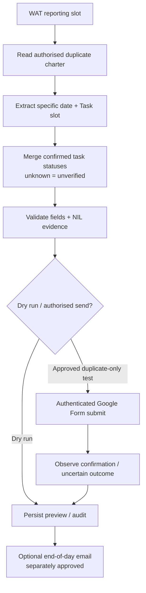

# Architecture and technical inventory

**Reviewed:** 2026-11-17, WAT. This documents the observed and planned system separately.

## Implemented system

```mermaid
flowchart TD
  GH["GitHub main\nsource, docs, CI tests"] -->|Manual workflow only; not configured for use| CF["Cloudflare Worker\nvephla-report-agent-test"]
  CF --> D1[("Dedicated Cloudflare D1\nstatus + report_runs")]
  CF -.->|OAuth not configured| GD["Duplicate Google Doc"]
  CF -.-X GF["Duplicate Google Form\nsubmission disabled"]
  CF -.-X EMAIL["Outgoing email\ndisabled"]
  CRON["Cron schedules: none"] -.-X CF
```

GitHub and Cloudflare are **not automatically synchronized**. GitHub contains modular source files; Cloudflare received an earlier standalone version uploaded directly via API. Treat parity as **unverified**, not as complete.

## Planned workflow (not active)



## Runtime

- Cloudflare account: Primary connection; do not create or modify resources in other accounts.
- Worker: `vephla-report-agent-test`, module Worker, deployed Nov 17.
- DB: `vephla-report-agent-test-db`, binding `DB`.
- Database tables:
  - `task_status(report_date, slot, task_index, status, updated_at)`, composite PK; statuses `completed`, `in-progress`, `blocked`, `unverified`.
  - `report_runs(id, report_date, slot, stage, content, created_at)`; unique `(report_date, slot, stage)`. **Not yet a complete idempotent submission ledger**.
- `ADMIN_TOKEN`: secret-text binding present in deployed Worker; do not disclose.
- No `GOOGLE_DOCS_ACCESS_TOKEN` in deployed settings at initial inspection. Even if added, short-lived tokens require refresh flow.
- Worker `workers.dev` disabled; previews disabled; Cron Triggers none. This means endpoints are **not publicly testable** without new explicit secure access setup.
- Form submit and email adapters absent from Worker and GitHub repo.
- `GET /health` returns generic status; all other endpoints require bearer auth. No public route is currently enabled.
- `GET /config`, `GET /preview?date=YYYY-MM-DD&slot=1..4`, `POST /status`, `GET /runs`.

## Code map

| Path | Responsibility |
|---|---|
| `src/config.mjs` | Test-only IDs, four slots, WAT, `NIL` |
| `src/parser.mjs` | Flatten Google Doc paragraphs/tables; date + Task extraction |
| `src/report.mjs` | Status mapping and truthful progress report |
| `src/index.mjs` | Worker HTTP API, bearer auth, D1 operations, disabled scheduler |
| `migrations/0001_initial.sql` | D1 tables |
| `fixtures/nov17-task2.json` | Synthetic representative sample; not independent work proof |
| `test/parser.test.mjs` | Parser/report unit tests |
| `scripts/safety-check.mjs` | Guard against incorrect doc/form IDs and senders |
| `scripts/deploy-test.mjs` | Manually gated Cloudflare API deploy; validates isolation |
| `.github/workflows/ci.yml` | Tests on push/PR; no deploy |
| `.github/workflows/deploy-test.yml` | Manual only; requires secrets and protected environment |

## Source data and output contract

**Authorized inputs:** Duplicate Google Doc only, with `NOVEMBER CHARTERS` tab `t.henz7cnke67i`. For 2026-11-17 Task 2, charter range is 8 AM–noon. The charter provides **assignments**, not evidence of completed work.

**Statuses:** Work is **unverified** unless separately confirmed. User-confirmed categories can be marked completed; the system must not infer that every substep in those categories occurred. Project Uni Flex *brief review* does not mean UI/prototype is finished.

**Form schema observed in browser:** signed-in Google respondent email, clock-in radio (1–4), Date, Time of Clock-In, Full Names, Official Email, Role, Month dropdown, Day dropdown, Progress Report text, Upload Verifications text. Actual form UI may evolve; no production assumptions.

**Evidence field:** Always literal `NIL`, per user. This does not assert evidence exists.

**Time:** Africa/Lagos, UTC+1; never backdate submission clock; classify historical reports distinctly from real-time attendance. Charter's 8 AM first reporting step and Form's 9 AM option need policy reconciliation before automatic scheduling.

## Authentication boundaries

The Google Drive connector that ChatGPT uses and the browser session previously used to submit the test form are **not** automatically available to Cloudflare. The Worker must obtain its own permissioned Google Docs OAuth credentials and refresh mechanism. The form respondent authentication may require an authorised managed browser session. Store all secrets in secure providers, not GitHub, docs, tickets, logs or CI artifacts.

## Security & privacy

- Repository was public as reviewed; do not add private work records, staff profiles, Google auth secrets, or SMTP passwords.
- Existing Worker has no public address; enable only protected routes with authorisation and opt-in.
- Prohibit production Doc/Form IDs in test deployment by validation; sending off until separately approved.
- Add durable submission ledger and halt-on-uncertain before implementing retries.
- Logs must redact personal data and authorization headers.
- Do not store the respondent account's password in this repository.

## Known limitations and differences

1. The current test fixture and parser unit test do not prove real Google Docs integration works.
2. Parsed paragraphs can include headings/instructions and may not directly correspond to five activity groups; classification work remains.
3. Task status keyed by list index can drift if source document changes; requires stable task identifiers.
4. The D1 `report_runs` table is a history stub, not a complete idempotency ledger.
5. Source code in GitHub is not guaranteed identical to manually uploaded standalone Worker.
6. No scheduled jobs or production form submission is active.
